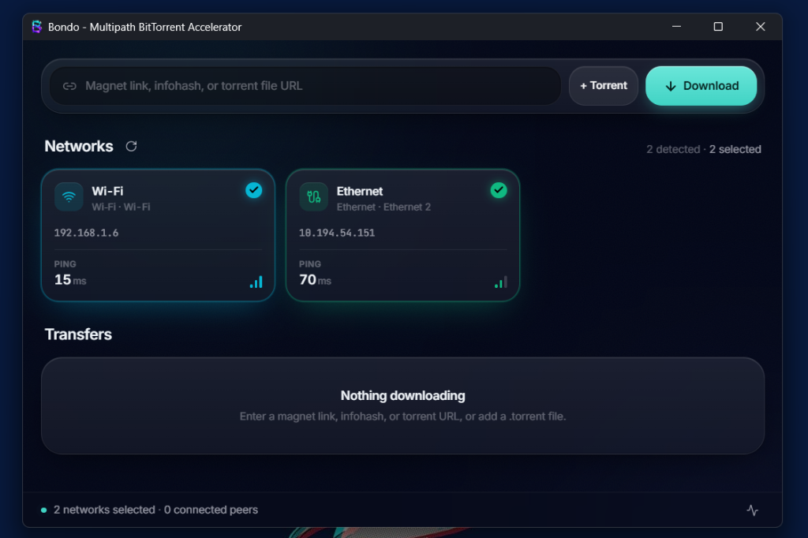

# Bondo — Multipath BitTorrent Accelerator

<div align="center">



<br/>

[](https://golang.org)
[](https://v2.wails.io)
[](https://react.dev)
[](https://www.typescriptlang.org)
[](https://microsoft.com)
[](LICENSE)

<br/>

**A high-performance Windows desktop BitTorrent accelerator engineered to bond multiple network interfaces for maximized peer-to-peer throughput.**

[Features](#-key-features) • [Quick Start](#-quick-start) • [How It Works](#-how-multipath-bonding-works) • [Build from Source](#-build-from-source) • [Architecture](#-architecture)

</div>

---

## 🌟 Key Features

### 🚀 Multipath Network Bonding
- **Aggregate Multiple Connections**: Simultaneously utilize Wi-Fi, Ethernet, USB tethering, or mobile hotspots to divide peer downloads across distinct physical interfaces.
- **Dynamic Adapter Telemetry**: Real-time detection of active network adapters with live ping latency indicators, IP resolution, and connection status.
- **On-the-Fly Adapter Toggling**: Selectively enable or disable individual network interfaces during active downloads with zero restart required.

### ⚡ Seamless Source Ingestion
- **Universal Input**: Paste magnet links (`magnet:?xt=urn:btih:...`), 40-char hex infohashes, 32-char base32 infohashes, or direct HTTP/HTTPS `.torrent` URLs.
- **Native File Picker (`+ Torrent`)**: Add local `.torrent` files instantly using native Windows dialogue.
- **Clipboard & Drag-Ready**: Direct `Ctrl+V` input support with instantaneous checksum detection.

### 🪟 Native Windows Integration
- **Zero-Config Protocol Registration**: Automatically registers the `magnet:` protocol for the current Windows user on launch.
- **Single-Instance Forwarding**: Clicking magnet links on web browsers automatically launches or brings the active Bondo window into focus and queues the transfer.
- **Clean Uninstallation**: Built-in CLI flag (`bondo.exe --unregister`) to cleanly remove user protocol associations without leaving orphaned registry entries.

### 💾 Smart Storage & Session Persistence
- **Intelligent Pathing**: Downloads land automatically in `%USERPROFILE%\Downloads` with real torrent name metadata resolution.
- **Collision Protection**: Automatic duplicate naming resolution (`Movie (2)`, `Movie (3)`) and sanitization of Windows-reserved characters.
- **Flattened Directory Hierarchy**: Prevents redundant double-nested folders for multi-file torrent packages.
- **Automatic Session Recovery**: Saves state to `%APPDATA%\Bondo\session.json`. Re-opens in hash-checking mode, fetching only damaged or missing pieces.

### 🎨 Modern Cyber-Dark User Experience
- Built with **React 19**, **Tailwind CSS**, and **Lucide Icons** on top of **Microsoft Edge WebView2**.
- Live piece matrix visualizer, per-adapter metrics, and real-time swarm peer telemetry.

---

## 📸 Interface Preview

<div align="center">
  
</div>

---

## 🚀 Quick Start

### Running Pre-Built Binary

1. Download or locate `build/bin/bondo.exe` (or run `run.bat`).
2. Ensure **Microsoft Edge WebView2 Runtime** is installed (included by default on Windows 10/11).
3. Launch Bondo:
   ```cmd
   bondo.exe
   ```
4. Select the network adapters you want to bond (e.g. Wi-Fi and Ethernet).
5. Paste a magnet link or click **+ Torrent** to start downloading at combined speeds.

### CLI Launch Flags

You can queue a torrent directly from PowerShell or Command Prompt:

```powershell
.\build\bin\bondo.exe --magnet "magnet:?xt=urn:btih:YOUR_INFOHASH"
```

To cleanly unregister Bondo from handling `magnet:` protocol links:

```powershell
.\build\bin\bondo.exe --unregister
```

---

## 🧠 How Multipath Bonding Works

Traditional BitTorrent clients bind all socket connections to `0.0.0.0`, leaving packet routing to the Windows Default Gateway (usually a single network interface).

```
                      ┌───────────────┐
                      │   Bondo UI    │
                      └───────┬───────┘
                              │
                    ┌─────────┴─────────┐
                    │ Multipath Pool    │
                    └────┬─────────┬────┘
                         │         │
       Bound to IP A     │         │ Bound to IP B
      ┌──────────────────┴─┐     ┌─┴──────────────────┐
      │  Wi-Fi Interface   │     │ Ethernet Interface │
      └─────────┬──────────┘     └─────────┬──────────┘
                ▼                          ▼
         Peers 1, 3, 5              Peers 2, 4, 6
                └────────────┬─────────────┘
                             ▼
                Maximum Combined Throughput
```

**Bondo's Approach:**
1. Enumerates all active local IPv4 network adapters.
2. Creates isolated outgoing TCP socket pools bound directly to the selected adapter IP addresses (`192.168.1.x`, `10.x.x.x`).
3. Distributes swarm peer connections across the distinct sockets, pulling unique payload blocks simultaneously over multiple physical connections.
4. Maintains tracker and DHT discovery through the primary routing table while multiplexing data payloads across all selected connections.

---

## 🛠️ Build from Source

### Prerequisites

- **Go**: 1.27 or newer ([Download Go](https://go.dev/dl/))
- **Node.js**: v22+ / v24+ ([Download Node](https://nodejs.org/))
- **Wails CLI v2.16.0**:
  ```bash
  go install github.com/wailsapp/wails/v2/cmd/wails@v2.16.0
  ```

### Step-by-Step Build

1. **Clone the repository**:
   ```bash
   git clone https://github.com/your-username/bondo.git
   cd bondo
   ```

2. **Install frontend dependencies**:
   ```bash
   cd frontend
   npm ci
   cd ..
   ```

3. **Compile the Windows executable**:
   ```cmd
   build.bat --no-pause
   ```
   *Or via PowerShell:*
   ```powershell
   .\build.ps1
   ```

The compiled binary will be placed at `build/bin/bondo.exe`.

### Development Mode

For rapid frontend UI iteration with Hot-Module-Replacement (HMR):

```bash
cd frontend
npm run dev
```

---

## 🧪 Tests & Quality Assurance

Run complete backend and frontend regression suites:

```powershell
# Run Go unit & integration tests
go test -v ./...

# Run Go static analysis
go vet ./...

# Run Frontend tests & TypeScript verification
cd frontend
npm test
npm run build
```

---

## 🏛️ Architecture & Technologies

| Layer | Technologies | Description |
| :--- | :--- | :--- |
| **Desktop Shell** | [Wails v2.16](https://v2.wails.io) | Lightweight Go-to-WebView2 bridge, native Windows window management. |
| **BitTorrent Engine** | [anacrolix/torrent](https://github.com/anacrolix/torrent) | High-performance Go BitTorrent protocol implementation with custom socket binding. |
| **Frontend Framework** | [React 19](https://react.dev) + [TypeScript 5.8](https://www.typescriptlang.org) | Declarative user interface with type safety. |
| **Styling & Assets** | [Tailwind CSS 3](https://tailwindcss.com) + [Lucide](https://lucide.dev) | Cyber-dark theme, glassmorphism, responsive telemetry badges. |
| **Build Tools** | [Vite 6](https://vitejs.dev) | Lightning-fast ESM frontend bundling. |

---

## 📄 License

This project is licensed under the [MIT License](LICENSE).
Feel free to contribute, open issues, and submit pull requests!
